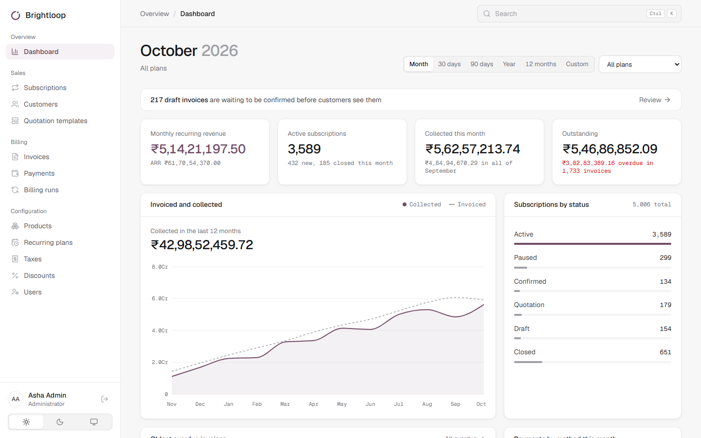
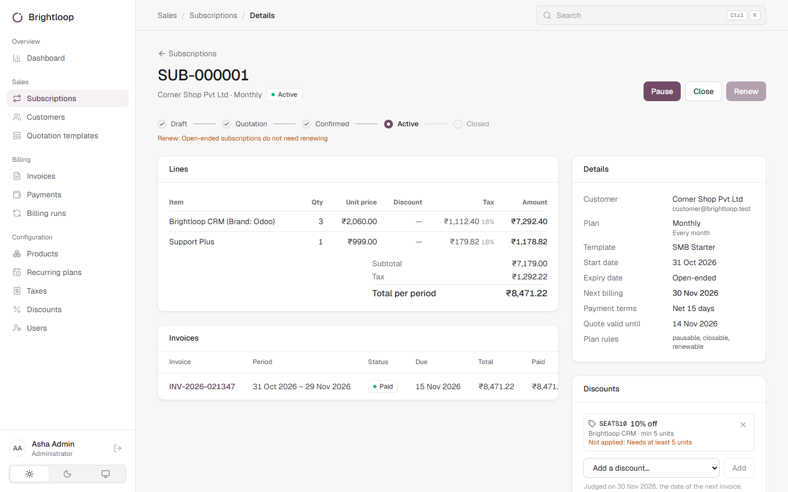
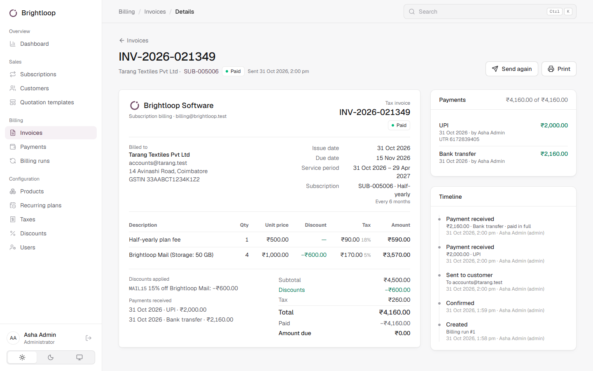
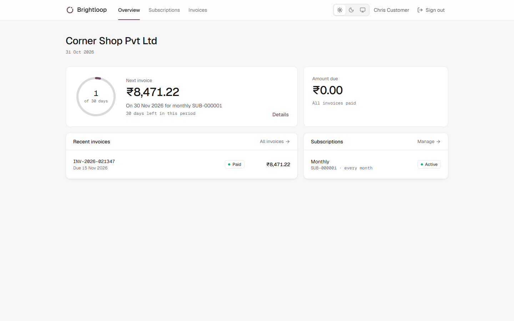
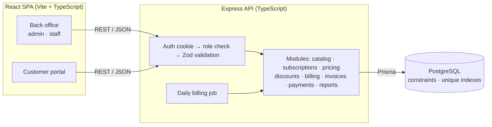
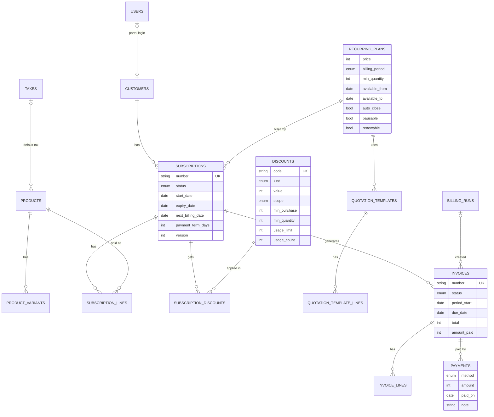

# Brightloop — Subscription Management System

One platform to run a subscription business: products and plans, quotes, subscriptions, recurring invoices, payments and revenue reporting. Built for the Odoo Hackathon.

## Demo accounts

| Role | Email | Password | Sign in at |
|---|---|---|---|
| Admin | `admin@brightloop.test` | `Admin@12345` | Login as Admin (`/login/team`) |
| Staff | `staff@brightloop.test` | `Staff@12345` | Login as Admin (`/login/team`) |
| Customer | `customer@brightloop.test` | `Customer@123` | Sign in (`/login`) |

## Features

- **Accounts and roles:** unique email, strong-password policy, emailed reset link. Admin, staff and customer roles; only the admin adds staff; customers see only their own data in a self-service portal.
- **Catalogue:** products with sales/cost price and priced variants; daily, weekly, monthly or yearly plans with minimum quantity, availability dates and close, pause and renew rules; automatic taxes.
- **Quotes and subscriptions:** quotation templates with validity days; lifecycle Draft → Quotation → Confirmed → Active → Closed (plus Paused) with an audit timeline.
- **Discounts:** fixed or %, minimums, date window and usage limit, for a product or a whole subscription; applied automatically and stopped when expired or used up.
- **Billing:** one run generates every due invoice; never bills twice and catches up missed periods. Invoices go Draft → Confirmed → Paid and can be sent, printed or cancelled.
- **Payments and reporting:** method, amount, date and note, partial payments; paid vs outstanding and overdue; dashboard with MRR/ARR, revenue and filters. Every page responds in under 2 s with 5,000 subscriptions.

## Screenshots

| Dashboard | Subscription |
|---|---|
|  |  |

| Invoice | Customer portal |
|---|---|
|  |  |

More in [`docs/screenshots/`](docs/screenshots/).

## Tech stack

| Layer | Technology |
|---|---|
| Frontend | React 19, TypeScript, Vite, Tailwind CSS 4, TanStack Query, React Hook Form + Zod, Recharts |
| Backend | Node.js, Express, TypeScript, Zod validation, node-cron (daily billing) |
| Database | **PostgreSQL** via Prisma ORM, with hand-written SQL constraints and indexes |
| Hosting (DB) | Supabase, used **only as a managed PostgreSQL database**. No Supabase Auth, SDK, storage or other SaaS features |
| Auth | Our own: bcrypt-hashed passwords, JWT in an httpOnly SameSite cookie, single-use hashed reset tokens |
| Testing | Vitest unit tests + API integration suites |

## Role-based access control (RBAC)

| Capability | Admin | Staff | Customer |
|---|:-:|:-:|:-:|
| Add / deactivate staff users | ✅ | ❌ | ❌ |
| Products, plans, taxes, discounts, templates | ✅ edit | 👁 read | ❌ |
| Customers, subscriptions, invoices, payments | ✅ | ✅ | own only |
| Run billing | ✅ | view runs | ❌ |
| Dashboard and reports | ✅ | ✅ | ❌ |
| Portal: pause / close / renew, pay invoice | — | — | own only, if the plan allows |

- Every API request passes through `authenticate → requireRole(...) → Zod validation` on the **server**; the UI only hides what the API already forbids.
- Customer data is scoped by the customer id from the session, never from the URL. Another customer's record returns **404**, so its existence isn't revealed.
- Role and active flag are re-checked on each request (30-second cache), so a deactivated user loses access within 30 seconds.

## Architecture



- **Modular monolith:** billing touches subscriptions, discounts, invoices and payments in one transaction, so one deployable keeps it consistent.
- **One pricing engine:** quotes, subscription totals and invoices use the same function.
- **Idempotent billing:** each period is claimed with a compare-and-set, backed by a unique index; missed periods are caught up.
- **Safe concurrent edits:** every write checks a `version`; a stale edit gets 409 instead of overwriting.
- **Money in paise** (integers) and rates in basis points, so there's no rounding drift. Invoices are snapshots, and overdue status is derived from the due date.

## Database schema



**Rules enforced by the database:**
- `UNIQUE (subscription_id, period_start)` on live invoices, so nothing is billed twice.
- Only one `RUNNING` billing run at a time.
- `CHECK` constraints: `usage_count ≤ usage_limit`, `amount_paid ≤ total`, positive payments, valid tax rates and date windows.
- Sequences produce subscription and invoice numbers.

## Run locally

Prerequisites: Node.js 20+, PostgreSQL 14+.

```bash
cd server && npm install && cp .env.example .env   # set DATABASE_URL, DIRECT_URL, JWT_SECRET
npx prisma migrate deploy && npm run seed           # add `npm run seed:perf` for 5,000 subscriptions
npm run dev                                          # API → http://localhost:4000
cd ../client && npm install && npm run dev           # App → http://localhost:5173
```

| Command (in `server/`) | Purpose |
|---|---|
| `npm test` | Unit tests: pricing, discounts, billing periods, state machine |
| `npm run test:api` | API suites: billing idempotency, concurrency, payments, permissions |
| `npm run perf` | Times every page's API against the 2-second budget |
| `npm run db:reset-demo -- --yes` | Wipe and re-seed demo data |

Emails print to the API console unless SMTP is set in `.env`. The online payment is simulated, and there's no proration.
